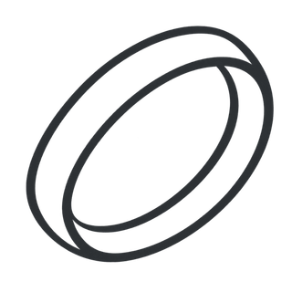
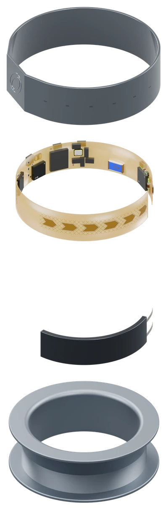
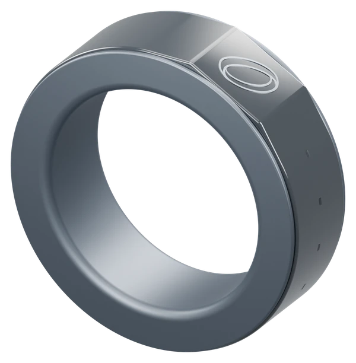
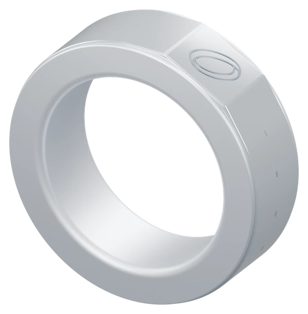
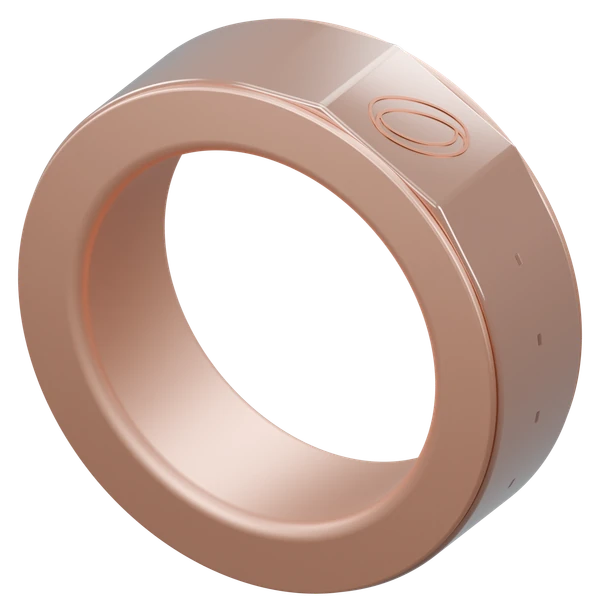
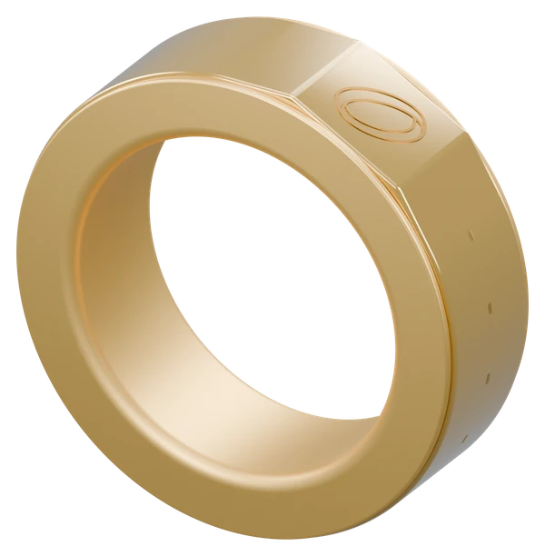

<p align="center">
  <a href="https://www.synoring.ai">
    
  </a>
</p>

<h1 align="center">SynoRing Labs</h1>

<p align="center">
  <strong>Your world, at your fingertips.</strong><br />
  Control your glasses without breaking the moment.
</p>

<p align="center">
  <a href="https://www.synoring.ai">Website</a> ·
  <a href="https://www.synoring.ai/demo">Interactive demo</a> ·
  <a href="https://www.synoring.ai/developers">Developers</a> ·
  <a href="https://www.synoring.ai/about">About us</a> ·
  <a href="https://x.com/SynoRing">X</a>
</p>

## Spatial computing needs a smaller gesture

AR glasses change where information lives. We’re exploring how we interact with it.

**SynoRing Labs is building a wearable gesture controller for AR and smart glasses.** By combining thumb touches with finger movements, SynoRing gives your hand a subtle way to select, scroll, and adjust what is in view.

Changing a track. Moving through a page. Bringing a map closer. These are small actions. We think the physical interaction should feel small, too.

Our focus is control that fits into everyday life: small movements at your side, relaxed hands, and attention that stays with the world around you.

## A touch of intent. A little movement.

Sensors read your movement. Touch gives it intent. Together, they let an application turn a small physical gesture into a meaningful action.

| Gesture | Interaction | Example uses |
| :--- | :--- | :--- |
| **Tap** | Select or confirm | Choose a track, confirm a choice, play media |
| **Glide** | Move through content | Scroll a page, browse items, move focus |
| **Clockwise circle** | Increase a value | Turn up the volume, enlarge text, zoom in |
| **Counterclockwise circle** | Decrease a value | Lower the volume, reduce text size, zoom out |
| **Hold** | Open app selection | Bring up the app launcher |

**Your context defines the action.** A circle can change volume in a music app and scale in a map. The gesture stays familiar while its meaning follows the task.

These are example mappings from our [browser interaction demo](https://www.synoring.ai/demo); final hardware mappings may evolve.

## See the interaction in action

Our browser demo explores three everyday spatial experiences:

| Experience | What to explore |
| :--- | :--- |
| **Music** | Select a track and adjust volume with small gestures. |
| **Reading** | Move through a page and adjust text size. |
| **Navigation** | Follow directions and change the map scale. |

[**Try the interactive demo →**](https://www.synoring.ai/demo)

The demo illustrates the interaction concept. Music is silent and the route is fictional.

## Inside the ring

We’re developing touch and motion sensing in a compact wearable form, with a ceramic shell, a flexible circuit, an arc battery, and a steel inner band.

<table>
  <tr>
    <td align="center" width="32%">
      
    </td>
    <td valign="middle">
      <h3>Ceramic shell</h3>
      <p>A thin glazed shell with six touch points over the electrodes.</p>
      <h3>Flexible circuit</h3>
      <p>A C-shaped board with outward-facing electrodes and electronics for motion sensing, gesture processing, and wireless connection.</p>
      <h3>Arc battery</h3>
      <p>A curved cell positioned just inside the touch area.</p>
      <h3>Steel inner band</h3>
      <p>A single stainless-steel piece whose rims form the ring’s two edges.</p>
    </td>
  </tr>
</table>

### Four finishes. One interaction idea.

<table>
  <tr>
    <td align="center" width="25%"><br /><strong>Space Gray</strong></td>
    <td align="center" width="25%"><br /><strong>Platinum</strong></td>
    <td align="center" width="25%"><br /><strong>Rose Gold</strong></td>
    <td align="center" width="25%"><br /><strong>Gold</strong></td>
  </tr>
</table>

<sub>Product images are concept renderings. Materials, sensing architecture, controls, and finishes are development targets and may change.</sub>

## Give your spatial app a sense of touch

We’re exploring a **phone-side SDK** that connects ring input with AR ecosystems. The intended integration flow is:

```text
SynoRing                    Phone-side software             Your spatial app
Touch + finger motion  →    Interpret and map gestures  →   Respond in context
```

The ring provides input. The software interprets it. Your application decides what that input means in the active screen or mode and gives the user clear feedback.

We’re interested in working with people building spatial readers, media interfaces, navigation experiences, and new forms of interaction. Real application needs will help shape the integration.

**The public SDK is not yet available.** This describes our development direction, not a released API or a confirmed device-support list.

[**Explore the developer direction →**](https://www.synoring.ai/developers)

## What guides the work

- **Intentional input.** Gestures should feel deliberate, and their results should be understandable. Clear feedback matters as much as recognition.
- **Everyday discretion.** Small movements and touch should fit naturally into the setting where the product is used.
- **Context comes first.** The same input should serve the current task, from changing volume to adjusting a view.

## Prototype. Learn. Refine.

| Area | Where things stand |
| :--- | :--- |
| **Interaction demo** | Available in the browser to explore gesture mappings and spatial experiences. |
| **Gesture experience** | Refining input, feedback, and everyday control through prototyping. |
| **Developer collaboration** | Open to conversations about use cases, integration needs, and future pilots. |
| **SDK and hardware pilots** | In development; public SDK downloads and hardware access are not yet available through the developer page. |
| **Device compatibility** | Being explored. Supported devices will be announced after validation. |
| **Production** | Hardware validation and confirmed specifications are part of the work ahead. |

For current R1 availability and launch updates, visit the [product page](https://www.synoring.ai/store).

## Bring a use case. Help shape the interface.

Tell us what you’re building:

1. **Your application:** What should someone be able to do without reaching for a screen?
2. **Your environment:** Which glasses, operating system, and companion device are you targeting?
3. **Your input needs:** Selection, scrolling, continuous adjustment, or something we haven’t imagined?

[**Discuss a developer pilot →**](mailto:contact@synoring.ai?subject=SynoRing%20Developer%20Pilot)

You can also [request early-access updates](mailto:contact@synoring.ai?subject=SynoRing%20Early%20Access) to follow product progress, developer pilots, and launch news.

---

<p align="center">
  <strong>SynoRing Labs</strong><br />
  Designed in the US. Manufactured in China.<br /><br />
  <a href="https://www.synoring.ai">synoring.ai</a> ·
  <a href="mailto:contact@synoring.ai">contact@synoring.ai</a> ·
  <a href="https://x.com/SynoRing">Follow on X</a>
</p>
